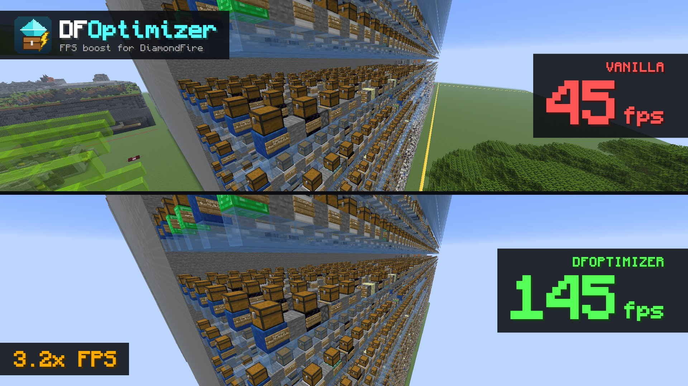

  

<h1 align="center">DFOptimizer</h1>

Client-side FPS boost for <a href="https://mcdiamondfire.com">DiamondFire</a>.

  

Big codespaces and busy neighbouring plots are what make DiamondFire heavy to render. DFOptimizer fixes both.

## Features

### Fast code chests

Every parameter chest in a codespace is normally a block entity, re-rendered every frame. A large codespace has
thousands of them. DFOptimizer bakes code chests into the world mesh as a static model, so they cost almost
nothing to draw. Chests anywhere else stay vanilla.

### Code sign text distance

Sign text is the most expensive thing in a codespace. DFOptimizer only draws the text of code signs within a
set distance (32 blocks by default). The signs themselves stay, and up close you can read everything as usual.
Code chests and code signs also stop ticking on your client, since there is nothing to animate.

### Plot filter

Only the plot you are on is rendered:

- **Neighbouring plots** and their codespaces are hidden: terrain, signs, chests, entities and particles.
- **Your own codespace** only shows in dev mode.
- **At spawn** nothing is hidden.

When DFOptimizer isn't sure where your plot is, it hides nothing.

### Plot detection

- **With [CodeClient](https://modrinth.com/mod/codeclient)**, its live plot info is used.
- **Without CodeClient**, DFOptimizer recognises the codespace next to your plot. This also works in play mode,
  so you don't need dev access.
- **Visited plots** are remembered per node.

## Settings

Open DFOptimizer in [Mod Menu](https://modrinth.com/mod/modmenu), or use:

- `/dfoptimizer` shows the status;
- `/dfoptimizer chests on|off` switches fast code chests;
- `/dfoptimizer plotfilter on|off` switches the plot filter;
- `/dfoptimizer signtext <blocks>` sets the code sign text distance (`0` = always draw).

## Compatibility

- **Requires:** Minecraft 26.3, Fabric Loader, Fabric API.
- **Works with:** Sodium (recommended), Iris, CodeClient and Mod Menu.
- **Without Sodium:** also works.

## Disclaimer

DFOptimizer is purely visual. It only changes what your own client draws, sends nothing to the server, automates
nothing and does nothing outside DiamondFire. It is not affiliated with DiamondFire.

## License

[MIT](LICENSE)
